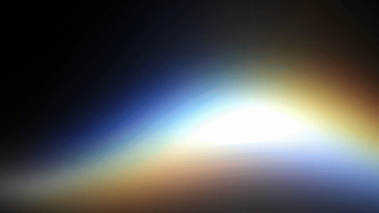

# Siri ribbon shader

Shader recreation of the iridescent ribbon in Apple's Siri AI retail video. The ribbon moves from right to left, spreads into a soft color field, and fades out.



[Full sequence (MP4)](docs/preview.mp4) · [GLSL](src/ribbon.frag) · [Metal](native/SiriRibbon.metal)

## Run

Requires Node.js 20.19+ and a browser with WebGL 2.

```sh
npm ci
npm run dev
```

The page includes a muted reference, a shared timeline, slow playback, and four shader controls. `?solo=1` opens the shader without loading the reference. `?time=1.43` pauses at the diffuse phase.

```sh
npm run build
npm run preview
```

The build uses relative asset paths and can be served from a repository subdirectory.

## How it works

Three phase-shifted Gaussian light bands follow a traveling wave. Their overlap forms a white core, while broader lobes produce the surrounding glow. A smooth transition widens the bands, separates their colors, attenuates the core, and reduces their intensity.

All pixels are calculated from coordinates, time, and parameters. The shader has no sampled textures, frame data, or video input. The reference is a separate video element used only for comparison. Coefficients were fitted offline to the reference; the runtime uses continuous functions, not a frame lookup table.

`src/ribbon.frag` is the source of truth. After editing it, regenerate the Metal port:

```sh
npm run sync:shaders
npm run check:shaders
```

This is an approximation of the light effect. Text, text-specific glow, and compression artifacts are outside its scope.

## Native Metal render

On a Mac with Xcode Command Line Tools and a Metal-capable GPU:

```sh
swiftc -O native/Render.swift -o /tmp/siri-render
/tmp/siri-render native/SiriRibbon.metal /tmp/siri.rgba
ffmpeg -f rawvideo -pixel_format rgba -video_size 960x540 -framerate 30 \
  -i /tmp/siri.rgba -c:v libx264 -crf 17 -pix_fmt yuv420p /tmp/siri.mp4
```

The renderer writes 107 frames at 960 × 540 and 30 fps. It reads the Metal source only. Optional arguments after the output path set frame count and width. The output file is overwritten if it exists.

## Credits and license

By [Mark By](https://github.com/mark-x64), developed with [OpenAI Codex](https://openai.com/codex/).

Original code and documentation: [MIT](LICENSE). The Apple reference excerpt is excluded; see [third-party notices](THIRD_PARTY_NOTICES.md).
